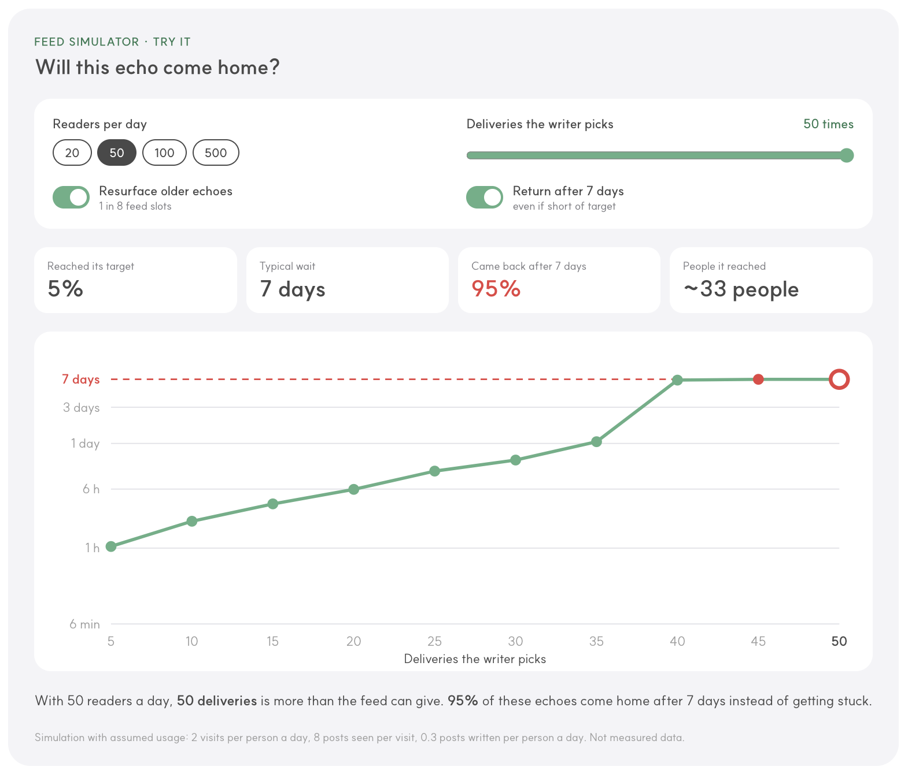

# AnonEcho feed simulator

A simulation I built before launching AnonEcho, an anonymous social app, to test whether the feed can deliver each echo to as many readers as the writer chooses, and to find where an echo might get stuck and never return.

**Live:** https://jetnue.github.io/anonecho-feed-simulator/

## Why
Before launch there was no usage data, so delivery rules couldn't be set from evidence. The simulation let me test candidate rules against a range of assumed scenarios before they went into the build.

## Assumptions (not real data)
| Input | Value | Reasoning |
|---|---|---|
| Daily readers | 20–500 | Beta size not yet known, so compared as a range |
| Visits per reader per day | 2 | Light, once-or-twice-a-day use |
| Echoes seen per visit | 8 | 2–3 cards per screen, 3–4 scrolls |
| Echoes written per reader per day | 0.3 | Far more readers than writers |
| Time of day | Curve | Reading peaks at commute, lunch and evening; writing peaks 10pm–1am |

## Rules tested
- Feed is ordered newest first.
- **Resurfacing:** 1 in every 8 slots shows an echo older than 24 hours that the reader hasn't seen in the last 12 hours, oldest first.
- The same reader counts again after 12 hours.
- **7-day return:** if an echo hasn't reached its target after 7 days, it returns to the writer anyway.

## What the simulation showed
The key variable is daily reading capacity (visits × echoes per visit) relative to daily writing volume. Once the target exceeds that capacity, the chance of an echo returning drops off a cliff.

| Daily readers | Result |
|---|---|
| 20 | Target 20 returns in about a day (median ~23 hours); target 40 reaches only 12%; target 50 reaches 0% |
| 50 | Target 50 reaches only 5%; the rest return via the 7-day rule |
| 100 | Most targets up to 50 are reached (target 50: 55%) |
| 500 | Target 50 returns in about 7 hours |

The 12-hour recount only makes a real difference when readers are very few. Because of the 7-day return, no echo stays in delivery forever.

## Decisions
- Writers are not shown an estimated return time. Not knowing when an echo will come back is part of the intended experience.
- Assumptions will be checked against beta data, and exposure settings such as the resurfacing ratio adjusted from there.

## How this was made
I built the simulation with Claude. I defined the scenarios, assumptions and delivery rules, read the results, and made the product decisions. Claude wrote the simulation code.

## Limitations
All results come from simulated readers and assumed behaviour, not real usage.
